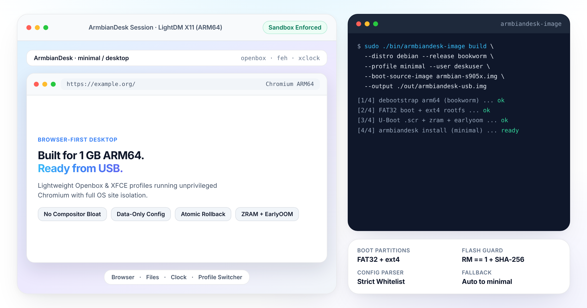
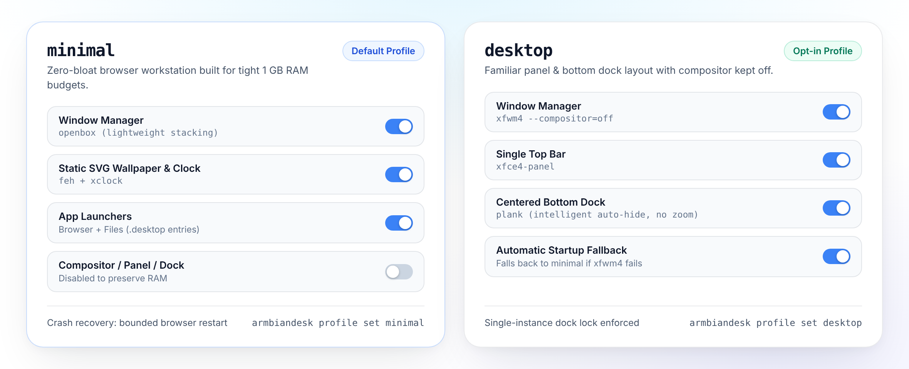
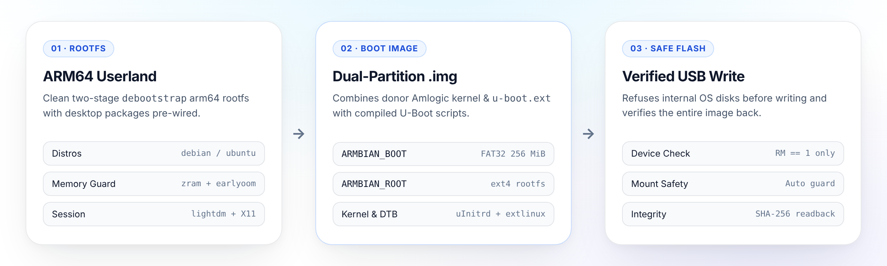

<h1 align="center">
  <a href="https://github.com/anggawahyudikp/ArmbianDesk">
    
    <br />
    ArmbianDesk
  </a>
</h1>

<p align="center">
  <a href="https://github.com/anggawahyudikp/ArmbianDesk/releases/latest"></a>
  <a href="https://github.com/anggawahyudikp/ArmbianDesk/actions/workflows/ci.yml"></a>
  <a href="LICENSE"></a>
</p>

<p align="center">
Toolkit desktop browser ringan &amp; pembuat flashdisk USB bootable untuk STB Armbian ARM64.
</p>

<p align="center">
  <a href="#mulai-sekarang">Mulai sekarang</a> ·
  <a href="#opsi-a-buat-flashdisk-usb-bootable-dari-nol">Panduan USB Bootable</a> ·
  <a href="#opsi-b-pasang-di-armbian-yang-sudah-boot">Pasang di Armbian</a> ·
  <a href="README.md">English</a> ·
  <a href="docs/HARDWARE.md">Matriks Hardware</a>
</p>

<p align="center">
  <picture>
    <source media="(prefers-color-scheme: dark)" srcset="docs/images/hero-dark.png">
    <source media="(prefers-color-scheme: light)" srcset="docs/images/hero-light.png">
    
  </picture>
</p>

<p align="center">
Ubah STB/SBC ARM64 ber-RAM ~1 GB (seperti ZTE B860H S905X) menjadi desktop X11 berfokus browser yang responsif —<br/>
buat langsung file <code>.img</code> flashdisk USB bootable dari nol atau pasang ke sistem Armbian X11 yang sudah berjalan.
</p>

---

<h2 align="center">Dua Profil untuk RAM 1 GB.</h2>

<p align="center">
Sesuaikan bobot desktop dengan kapasitas RAM perangkat Anda —<br/>
mulai dari sesi Openbox super-ringan hingga tata letak panel atas dan dock bawah.
</p>

<p align="center">
  <picture>
    <source media="(prefers-color-scheme: dark)" srcset="docs/images/profiles-dark.png">
    <source media="(prefers-color-scheme: light)" srcset="docs/images/profiles-light.png">
    
  </picture>
</p>

- **`minimal`** *(default)* — `openbox`, wallpaper SVG statis (`feh`), jam digital (`xclock`), launcher Browser & Files, tanpa compositor maupun dock.
- **`desktop`** *(opt-in)* — `xfwm4 --compositor=off`, satu top bar fungsional `xfce4-panel`, satu dock bawah `plank` (*intelligent auto-hide*, tanpa animasi zoom/suara startup), serta fallback otomatis ke `minimal` bila `xfwm4` gagal.

---

<h2 align="center">Flashdisk Bootable dalam Satu Perintah.</h2>

<p align="center">
Bangun image ARM64 dua-partisi (<code>ARMBIAN_BOOT</code> FAT32 + <code>ARMBIAN_ROOT</code> ext4) lengkap dengan<br/>
<code>debootstrap</code>, kernel &amp; <code>u-boot.ext</code> donor, U-Boot autoscript, <code>zram</code> + <code>earlyoom</code>, dan ArmbianDesk siap pakai.
</p>

<p align="center">
  <picture>
    <source media="(prefers-color-scheme: dark)" srcset="docs/images/usb-pipeline-dark.png">
    <source media="(prefers-color-scheme: light)" srcset="docs/images/usb-pipeline-light.png">
    
  </picture>
</p>

---

## Mulai sekarang

### 0. Ambil Source ArmbianDesk

Clone repository atau unduh arsip rilis resmi `v0.1.0` dan verifikasi checksum SHA-256:

```bash
# Cara 1: Git clone
git clone https://github.com/anggawahyudikp/ArmbianDesk.git
cd ArmbianDesk

# Cara 2: Unduh ZIP rilis + verifikasi SHA-256
curl -LO https://github.com/anggawahyudikp/ArmbianDesk/releases/download/v0.1.0/ArmbianDesk-0.1.0-source.zip
curl -LO https://github.com/anggawahyudikp/ArmbianDesk/releases/download/v0.1.0/ArmbianDesk-0.1.0-source.zip.sha256
sha256sum -c ArmbianDesk-0.1.0-source.zip.sha256
unzip ArmbianDesk-0.1.0-source.zip && cd ArmbianDesk-0.1.0
```

Pilih **Opsi A** untuk membuat flashdisk USB bootable dari mesin Linux, atau **Opsi B** jika STB/SBC Anda sudah berjalan di Armbian ARM64.

---

### Opsi A: Buat Flashdisk USB Bootable dari Nol

Jalankan langkah berikut di PC/server Linux `x86_64` atau `arm64` berbasis Debian/Ubuntu.

#### 1. Pasang dependensi host builder

```bash
sudo apt-get update
sudo apt-get install -y \
  debootstrap qemu-user-static parted dosfstools e2fsprogs u-boot-tools xz-utils
```

#### 2. Siapkan kernel & bootloader donor

Sediakan **salah satu** sumber:
- `--boot-source-image /path/ke/official-armbian-s905x.img` (mendukung `.img`, `.img.gz`, `.img.xz` — otomatis mengekstrak kernel `Image`, `/lib/modules`, `/boot/dtb`, dan `u-boot.ext`), **atau**
- `--kernel-tar /path/ke/kernel.tar` + `--uboot-dir /path/ke/uboot/`.

#### 3. Cek rencana build (dry-run tanpa root)

```bash
./bin/armbiandesk-image build \
  --distro debian --release bookworm \
  --profile minimal \
  --user deskuser \
  --boot-source-image /path/ke/official-armbian-s905x.img \
  --dtb amlogic/meson-gxl-s905x-p212.dtb \
  --cma-mb 64 \
  --output ./out/armbiandesk-usb.img \
  --dry-run
```

> Ingin memakai Ubuntu atau profil `desktop`? Ganti dengan `--distro ubuntu --release noble` dan/atau `--profile desktop`. Jalankan `./bin/armbiandesk-image build --help` untuk opsi `--size-mb`, `--boot-mb`, `--hostname`, dan `--start-url`.

#### 4. Bangun file `.img` bootable

Buat hash password SHA-512 terlebih dahulu agar password polos tidak masuk ke history shell (jika `--password-hash` dilewati, sistem meminta pembuatan password saat login pertama):

```bash
HASH="$(openssl passwd -6)"

sudo ./bin/armbiandesk-image build \
  --distro debian --release bookworm \
  --profile minimal \
  --user deskuser \
  --password-hash "$HASH" \
  --boot-source-image /path/ke/official-armbian-s905x.img \
  --dtb amlogic/meson-gxl-s905x-p212.dtb \
  --cma-mb 64 \
  --output ./out/armbiandesk-usb.img \
  --compress
```

#### 5. Tulis aman ke flashdisk USB

1. Cek nama disk flashdisk Anda (pastikan `RM=1` dan `TRAN=usb`, gunakan device disk utuh seperti `/dev/sdb` — bukan partisi `/dev/sdb1`):
   ```bash
   lsblk -d -o NAME,RM,TRAN,SIZE,MODEL
   ```
2. Simulasi lebih dulu, lalu flash dan verifikasi SHA-256 readback:
   ```bash
   ./bin/armbiandesk-image flash --image ./out/armbiandesk-usb.img --device /dev/sdX --dry-run
   sudo ./bin/armbiandesk-image flash --image ./out/armbiandesk-usb.img --device /dev/sdX
   ```

> **Catatan STB Android Bawaan:** Pada revisi tertentu ZTE B860H, U-Boot bawaan memerlukan aktivasi USB-first-boot terlebih dahulu. Baca [docs/HARDWARE.md](docs/HARDWARE.md) dan [tools/b860h-usb-prep/README.md](tools/b860h-usb-prep/README.md) secara cermat sebelum mengubah variabel U-Boot eMMC.

---

### Opsi B: Pasang di Armbian yang Sudah Boot

Jalankan langsung di sistem Debian/Ubuntu/Armbian ARM64 Anda via SSH atau terminal.

#### 1. Pasang paket desktop & helper RAM rendah

```bash
sudo apt-get update

# Wajib untuk profil default minimal:
sudo apt-get install -y xorg x11-xserver-utils x11-utils x11-apps openbox feh wmctrl xdotool thunar chromium

# Tambahan opsional jika memakai profil desktop (xfwm4 + xfce4-panel + plank):
sudo apt-get install -y xfwm4 xfce4-panel plank libglib2.0-bin

# Disarankan untuk perangkat RAM 1 GB:
sudo apt-get install -y zram-tools earlyoom
```

> **Catatan Ubuntu ARM64:** Cek `apt-cache policy chromium` untuk memastikan apakah `chromium` berupa `.deb` native atau wrapper Snap. ArmbianDesk menargetkan Chromium `.deb` native bila tersedia.

#### 2. Dry-run dan pasang ArmbianDesk

Ganti `USER` dengan username desktop non-root yang sudah ada (`install` menolak `root` maupun user yang belum terdaftar):

```bash
# 1. Pratinjau seluruh target file tanpa mengubah sistem
./bin/armbiandesk install --user USER --profile minimal --dry-run

# 2. Pasang resmi (mendaftarkan sesi LightDM tanpa mengubah sesi aktif atau autologin)
sudo ./bin/armbiandesk install --user USER --profile minimal
```

Catat **`Backup ID`** yang dicetak di akhir instalasi (disimpan di `/var/lib/armbiandesk/backups/<BACKUP_ID>`).

#### 3. Opsional: Aktifkan autologin LightDM

Untuk masuk otomatis ke sesi `armbiandesk` melalui drop-in terpisah (`/etc/lightdm/lightdm.conf.d/50-armbiandesk-autologin.conf`):

```bash
sudo ./bin/armbiandesk install --user USER --profile minimal --enable-autologin
```

#### 4. Konfigurasi, ganti profil, atau uninstall aman

```bash
# Edit /etc/armbiandesk/armbiandesk.conf (START_URL, LANGUAGE, BROWSER_COMPATIBILITY, dll.), lalu validasi:
sudo armbiandesk config validate --file /etc/armbiandesk/armbiandesk.conf

# Ganti profil minimal <-> desktop (berlaku pada login berikutnya)
sudo armbiandesk profile set desktop

# Cek status konfigurasi dan sesi aktif
armbiandesk status --json

# Uninstall bersih (menjaga profil Chromium, bookmark, SSH, dan paket distro tetap utuh)
sudo armbiandesk uninstall --user USER --dry-run
sudo armbiandesk uninstall --user USER

# Atau kembalikan file sebelum instalasi menggunakan Backup ID
sudo armbiandesk restore --backup <BACKUP_ID> --dry-run
sudo armbiandesk restore --backup <BACKUP_ID>
```

---

<h2 align="center">Aman &amp; Terisolasi Sejak Awal.</h2>

| Jaminan | Mekanisme di ArmbianDesk |
| --- | --- |
| **Sandbox Browser Utuh** | Chromium berjalan sebagai user non-root tanpa `--no-sandbox`; isolasi situs OS tetap aktif. |
| **Konfigurasi Data-Only** | [`/etc/armbiandesk/armbiandesk.conf`](config/armbiandesk.conf.example) divalidasi parser whitelist ketat (`lib/config.sh`), tidak pernah di-`source` atau `eval`. |
| **Backup &amp; Rollback Atomik** | `install` membuat manifest `0600`, otomatis rollback jika gagal di tengah jalan, dan menjaga profil browser saat `uninstall`. |
| **Proteksi Flash USB** | `armbiandesk-image flash` menolak disk non-removable (`RM != 1`) dan partisi sistem yang sedang ter-mount. |

---

## Dokumentasi &amp; Kontribusi

- Panduan lengkap: [Image Builder](docs/IMAGE_BUILDER.md) · [Instalasi](docs/INSTALL.md) · [Uninstall & Restore](docs/UNINSTALL.md) · [Matriks Hardware](docs/HARDWARE.md) · [Laporan Uji](TEST_REPORT.md)
- Dirilis dengan [Lisensi MIT](LICENSE). Lihat [THIRD_PARTY_NOTICES.md](THIRD_PARTY_NOTICES.md) untuk daftar paket pihak ketiga. Laporan bug, hasil uji revisi hardware, dan pull request sangat diterima.
