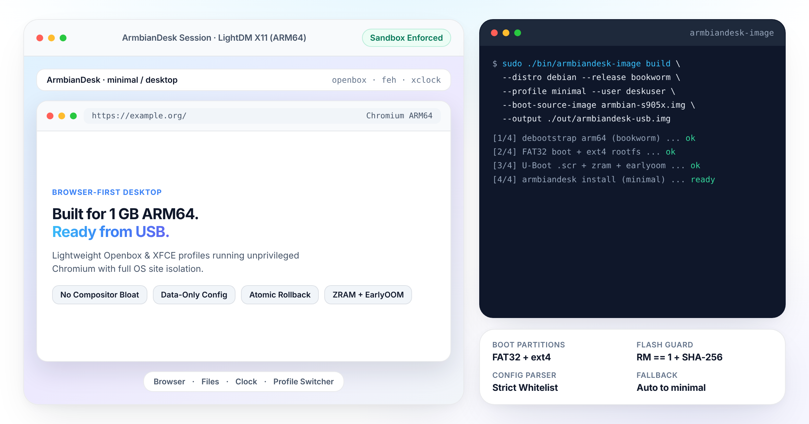

<h1 align="center">
  <a href="https://github.com/anggawahyudikp/ArmbianDesk">
    
    <br />
    ArmbianDesk
  </a>
</h1>

<p align="center">
  <a href="https://github.com/anggawahyudikp/ArmbianDesk/releases/latest"></a>
  <a href="https://github.com/anggawahyudikp/ArmbianDesk/actions/workflows/ci.yml"></a>
  <a href="LICENSE"></a>
</p>

<p align="center">
Turn a 1 GB ARM64 TV box into a clean browser desktop — straight from a USB flash drive.
</p>

<p align="center">
  <a href="https://github.com/anggawahyudikp/ArmbianDesk/releases/download/v0.1.0/armbiandesk-b860h-minimal.img.xz">Download Bootable Image</a> ·
  <a href="#get-started">3-Step USB Guide</a> ·
  <a href="README.id.md">Bahasa Indonesia</a> ·
  <a href="docs/HARDWARE.md">Hardware Support</a>
</p>

<p align="center">
  <picture>
    <source media="(prefers-color-scheme: dark)" srcset="docs/images/hero-dark.png">
    <source media="(prefers-color-scheme: light)" srcset="docs/images/hero-light.png">
    
  </picture>
</p>

<p align="center">
No manual Linux setup required. Download the ready-to-flash bootable <code>.img.xz</code> file,<br/>
write it to a USB flash drive with <b>Raspberry Pi Imager</b> or <b>balenaEtcher</b>, plug it in, and boot.
</p>

---

## Get started

### Step 1 — Download the Bootable Image

Download the compressed bootable image for **Amlogic S905X (`p212` / B860H-style 1 GB TV boxes)**:

- **Bootable Image:** [`armbiandesk-b860h-minimal.img.xz`](https://github.com/anggawahyudikp/ArmbianDesk/releases/download/v0.1.0/armbiandesk-b860h-minimal.img.xz) *(561 MB compressed → 3.5 GB image, Debian 12 `bookworm` ARM64, Chromium + Openbox + `zram` + `earlyoom`)*
- **Checksum:** [`armbiandesk-b860h-minimal.img.xz.sha256`](https://github.com/anggawahyudikp/ArmbianDesk/releases/download/v0.1.0/armbiandesk-b860h-minimal.img.xz.sha256)

> **Beta Testing Notice:** This `.img.xz` file has passed full build, partition, boot-script, and SHA-256 verification, **but has not yet been cold-boot tested on physical hardware**. Default user is `deskuser` with temporary password `deskuser` — please run `passwd` after your first boot to change it.

### Step 2 — Flash to a USB Flash Drive

1. Plug a USB flash drive (**4 GB or larger**; all existing data on the USB drive will be erased) into your Windows, macOS, or Linux PC.
2. Flash **`armbiandesk-b860h-minimal.img.xz`** directly (no need to unzip first):
   - **Raspberry Pi Imager:** *Choose OS → Use custom → select `.img.xz` → Choose Storage → select your USB drive → Next*.
   - **balenaEtcher:** *Flash from file → select `.img.xz` → Select target → Flash!*
   - **Linux Terminal (optional):**
     ```bash
     xz -dk armbiandesk-b860h-minimal.img.xz
     sudo ./bin/armbiandesk-image flash --image ./armbiandesk-b860h-minimal.img --device /dev/sdX
     ```

### Step 3 — Plug Into Your TV Box & Boot

1. Insert the flashed USB drive into **USB Port 0** on your TV box (try every USB port if unsure — stock bootloaders often check only Port 0).
2. Connect HDMI + mouse/keyboard and power on the box.
   - **Boxes that already booted Armbian before** usually detect the USB drive and start ArmbianDesk automatically.
   - ArmbianDesk automatically signs in as `deskuser` and opens Chromium. Open a terminal and run `passwd` to change the default temporary password (`deskuser`).

### USB Drive Not Detected (Box Still Boots Stock Android)?

Unlike a PC, factory-locked Amlogic/B860H TV boxes do not always check USB drives on normal power-on. Follow these steps in order — see [docs/USB_BOOT_GUIDE.md](docs/USB_BOOT_GUIDE.md) for the complete guide:

1. **Try the Reset / AV Pinhole Button ("Toothpick Method"):**
   Unplug power, insert the USB drive into **USB Port 0**, press and hold the internal **RESET / AV** pinhole button with a toothpick, plug in power while holding for **5–10 seconds**, then release.
2. **Or trigger Update Mode via ADB (from Android):**
   Enable *USB Debugging* on stock Android, connect from your PC (`adb connect <BOX_IP>:5555`), then run:
   ```bash
   adb reboot update
   ```
3. **For factory-locked ZTE B860H units that still skip USB:**
   Enable USB-first boot in U-Boot (`/dev/block/env`) safely with backup + byte-for-byte `cmp` verification — full copy-paste steps in [docs/USB_BOOT_GUIDE.md](docs/USB_BOOT_GUIDE.md#method-3--enable-persistent-usb-first-boot-on-locked-zte-b860h-boxes-adb--root) and [tools/b860h-usb-prep/README.md](tools/b860h-usb-prep/README.md).

---

<h2 align="center">Profiles That Fit 1 GB.</h2>

<p align="center">
Keep RAM lean by default, or switch to a classic panel + auto-hide dock layout in one command.
</p>

<p align="center">
  <picture>
    <source media="(prefers-color-scheme: dark)" srcset="docs/images/profiles-dark.png">
    <source media="(prefers-color-scheme: light)" srcset="docs/images/profiles-light.png">
    
  </picture>
</p>

- **`minimal`** *(pre-installed default)* — `openbox`, static SVG wallpaper (`feh`), lightweight clock (`xclock`), Browser & Files launchers, zero compositor or dock overhead.
- **`desktop`** *(optional)* — switch anytime after installing XFCE/Plank packages (`sudo armbiandesk profile set desktop` — takes effect on next login) for `xfwm4 --compositor=off`, one `xfce4-panel` top bar, and one centered auto-hide `plank` dock.

---

<h2 align="center">Sandboxed &amp; Safe by Design.</h2>

| Guarantee | How ArmbianDesk Enforces It |
| --- | --- |
| **OS Browser Sandboxing** | Chromium runs strictly as an unprivileged user (`deskuser`) — zero `--no-sandbox` shortcuts; site isolation stays enabled. |
| **Low-RAM Protection** | `zram-tools` (`lz4`, 100%) + `earlyoom` keep 1 GB RAM boxes responsive under browser load. |
| **Data-Only Config** | `/etc/armbiandesk/armbiandesk.conf` is validated by a strict whitelist parser (`lib/config.sh`), never executed as shell. |
| **Safe USB Flasher** | `armbiandesk-image flash` rejects internal disks (`RM != 1`) and mounted OS partitions, then verifies SHA-256 readback. |

---

<details>
<summary><b>Advanced: Build Your Own Custom Image or Install on Existing Armbian</b></summary>

<br/>

<p align="center">
  <picture>
    <source media="(prefers-color-scheme: dark)" srcset="docs/images/usb-pipeline-dark.png">
    <source media="(prefers-color-scheme: light)" srcset="docs/images/usb-pipeline-light.png">
    
  </picture>
</p>

- **Build your own `.img` from scratch** (`debootstrap` Debian/Ubuntu + custom `--dtb` / `--start-url` / `--profile`): see [docs/IMAGE_BUILDER.md](docs/IMAGE_BUILDER.md).
- **Install onto an already-booted Armbian ARM64 X11 system**: see [docs/INSTALL.md](docs/INSTALL.md).
- **Uninstall or restore backups cleanly**: see [docs/UNINSTALL.md](docs/UNINSTALL.md).

</details>

## Documentation &amp; Credits

- **Guides:** [USB Boot Guide](docs/USB_BOOT_GUIDE.md) · [Hardware Support](docs/HARDWARE.md) · [Troubleshooting](docs/TROUBLESHOOTING.md) · [Image Builder](docs/IMAGE_BUILDER.md) · [Privacy](docs/PRIVACY.md) · [Test Report](TEST_REPORT.md)
- **Contribute:** Bug reports, board boot reports, and pull requests are welcome! See [CONTRIBUTING.md](CONTRIBUTING.md) and [SECURITY.md](SECURITY.md).
- **License:** Original ArmbianDesk scripts, templates, and assets are licensed under the [MIT License](LICENSE). Bootable image releases also include Debian `bookworm` packages, Linux kernel, and U-Boot components under their upstream licenses (GPL-2.0 / GPL-2.0+ / BSD) — see [THIRD_PARTY_NOTICES.md](THIRD_PARTY_NOTICES.md) for source provenance.
