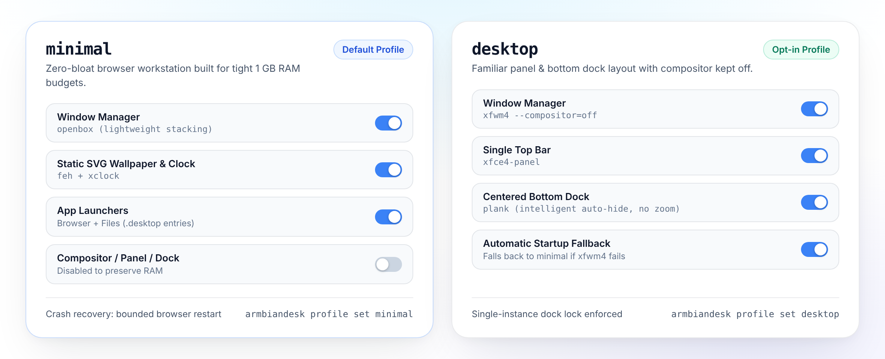
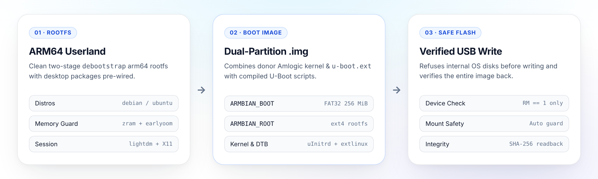

<h1 align="center">
  <a href="https://github.com/anggawahyudikp/ArmbianDesk">
    
    <br />
    ArmbianDesk
  </a>
</h1>

<p align="center">
  <a href="https://github.com/anggawahyudikp/ArmbianDesk/releases/latest"></a>
  <a href="https://github.com/anggawahyudikp/ArmbianDesk/actions/workflows/ci.yml"></a>
  <a href="LICENSE"></a>
</p>

<p align="center">
The lightweight browser desktop &amp; bootable USB toolkit for Armbian ARM64 TV boxes.
</p>

<p align="center">
  <a href="#get-started">Get started</a> ·
  <a href="#option-a-bootable-usb-from-scratch">Bootable USB Guide</a> ·
  <a href="#option-b-install-on-booted-armbian">Live Armbian Install</a> ·
  <a href="README.id.md">Bahasa Indonesia</a> ·
  <a href="docs/HARDWARE.md">Hardware Matrix</a>
</p>

<p align="center">
  <picture>
    <source media="(prefers-color-scheme: dark)" srcset="docs/images/hero-dark.png">
    <source media="(prefers-color-scheme: light)" srcset="docs/images/hero-light.png">
    
  </picture>
</p>

<p align="center">
Turn a 1 GB RAM ARM64 TV box (such as ZTE B860H S905X hardware) into a clean, browser-first workstation —<br/>
build a ready-to-flash USB <code>.img</code> from scratch or install onto an already-booted Armbian X11 system.
</p>

---

<h2 align="center">Profiles That Fit 1 GB.</h2>

<p align="center">
Different hardware budgets deserve different session weights.<br/>
Switch cleanly between a zero-overhead Openbox workspace and a familiar panel + dock layout.
</p>

<p align="center">
  <picture>
    <source media="(prefers-color-scheme: dark)" srcset="docs/images/profiles-dark.png">
    <source media="(prefers-color-scheme: light)" srcset="docs/images/profiles-light.png">
    
  </picture>
</p>

- **`minimal`** *(default)* — `openbox`, static SVG wallpaper (`feh`), lightweight clock (`xclock`), Browser & Files launchers, zero compositor or resident dock overhead.
- **`desktop`** *(opt-in)* — `xfwm4 --compositor=off`, one functional `xfce4-panel` top bar, one centered `plank` bottom dock with intelligent auto-hide (animations, zoom, and startup sounds off), and automatic fallback to `minimal` if `xfwm4` fails.

---

<h2 align="center">Bootable USB, Dialed In.</h2>

<p align="center">
Build a clean dual-partition ARM64 <code>.img</code> from scratch with <code>debootstrap</code>,<br/>
donor kernel &amp; <code>u-boot.ext</code>, compiled U-Boot autoscripts, <code>zram</code> + <code>earlyoom</code>, and ArmbianDesk pre-installed.
</p>

<p align="center">
  <picture>
    <source media="(prefers-color-scheme: dark)" srcset="docs/images/usb-pipeline-dark.png">
    <source media="(prefers-color-scheme: light)" srcset="docs/images/usb-pipeline-light.png">
    
  </picture>
</p>

---

## Get started

### 0. Download ArmbianDesk

Clone the repository or download and verify the latest release archive (`v0.1.0`):

```bash
# Option 1: Git clone
git clone https://github.com/anggawahyudikp/ArmbianDesk.git
cd ArmbianDesk

# Option 2: Download release ZIP + verify SHA-256
curl -LO https://github.com/anggawahyudikp/ArmbianDesk/releases/download/v0.1.0/ArmbianDesk-0.1.0-source.zip
curl -LO https://github.com/anggawahyudikp/ArmbianDesk/releases/download/v0.1.0/ArmbianDesk-0.1.0-source.zip.sha256
sha256sum -c ArmbianDesk-0.1.0-source.zip.sha256
unzip ArmbianDesk-0.1.0-source.zip && cd ArmbianDesk-0.1.0
```

Choose **Option A** to create a bootable USB flash drive on a Linux PC, or **Option B** if your TV box / SBC already boots Armbian ARM64.

---

### Option A: Bootable USB from Scratch

Run these steps on an `x86_64` or `arm64` Debian/Ubuntu Linux host.

#### 1. Install host build dependencies

```bash
sudo apt-get update
sudo apt-get install -y \
  debootstrap qemu-user-static parted dosfstools e2fsprogs u-boot-tools xz-utils
```

#### 2. Prepare a donor kernel & bootloader

Provide **either**:
- `--boot-source-image /path/to/official-armbian-s905x.img` (supports `.img`, `.img.gz`, `.img.xz` — extracts kernel `Image`, `/lib/modules`, `/boot/dtb`, and `u-boot.ext`), **or**
- `--kernel-tar /path/to/kernel.tar` + `--uboot-dir /path/to/uboot/`.

#### 3. Preview the build plan (dry-run, no root required)

```bash
./bin/armbiandesk-image build \
  --distro debian --release bookworm \
  --profile minimal \
  --user deskuser \
  --boot-source-image /path/to/official-armbian-s905x.img \
  --dtb amlogic/meson-gxl-s905x-p212.dtb \
  --cma-mb 64 \
  --output ./out/armbiandesk-usb.img \
  --dry-run
```

> Want Ubuntu or the `desktop` profile instead? Swap `--distro ubuntu --release noble` and/or `--profile desktop`. See `./bin/armbiandesk-image build --help` for `--size-mb`, `--boot-mb`, `--hostname`, and `--start-url`.

#### 4. Build the bootable `.img`

Generate a SHA-512 password hash first so cleartext passwords never enter shell history (omit `--password-hash` to force password creation at first login):

```bash
HASH="$(openssl passwd -6)"

sudo ./bin/armbiandesk-image build \
  --distro debian --release bookworm \
  --profile minimal \
  --user deskuser \
  --password-hash "$HASH" \
  --boot-source-image /path/to/official-armbian-s905x.img \
  --dtb amlogic/meson-gxl-s905x-p212.dtb \
  --cma-mb 64 \
  --output ./out/armbiandesk-usb.img \
  --compress
```

#### 5. Flash safely to a removable USB drive

1. Identify the whole USB disk device (verify `RM=1` and `TRAN=usb`, e.g. `/dev/sdb` — never a partition like `/dev/sdb1`):
   ```bash
   lsblk -d -o NAME,RM,TRAN,SIZE,MODEL
   ```
2. Dry-run first, then flash and verify SHA-256 readback:
   ```bash
   ./bin/armbiandesk-image flash --image ./out/armbiandesk-usb.img --device /dev/sdX --dry-run
   sudo ./bin/armbiandesk-image flash --image ./out/armbiandesk-usb.img --device /dev/sdX
   ```

> **Stock Android TV Boxes:** Some ZTE B860H revisions require USB-first-boot activation before stock U-Boot probes USB drives. Read [docs/HARDWARE.md](docs/HARDWARE.md) and [tools/b860h-usb-prep/README.md](tools/b860h-usb-prep/README.md) carefully before touching eMMC U-Boot variables.

---

### Option B: Install on Booted Armbian

Run these steps directly on your booted Debian/Ubuntu/Armbian ARM64 system over SSH or terminal.

#### 1. Install desktop & low-RAM dependencies

```bash
sudo apt-get update

# Required for the default minimal profile:
sudo apt-get install -y xorg x11-xserver-utils x11-utils x11-apps openbox feh wmctrl xdotool thunar chromium

# Optional additions for the desktop profile (xfwm4 + xfce4-panel + plank):
sudo apt-get install -y xfwm4 xfce4-panel plank libglib2.0-bin

# Recommended low-RAM helpers:
sudo apt-get install -y zram-tools earlyoom
```

> **Ubuntu ARM64 note:** Run `apt-cache policy chromium` to verify whether `chromium` is a native `.deb` or a Snap wrapper. ArmbianDesk targets native `.deb` Chromium where available.

#### 2. Dry-run and install ArmbianDesk

Replace `USER` with your existing non-root desktop username (`install` rejects `root` and unknown users):

```bash
# 1. Preview all target paths without modifying the filesystem
./bin/armbiandesk install --user USER --profile minimal --dry-run

# 2. Install (registers LightDM session without changing active sessions or enabling autologin)
sudo ./bin/armbiandesk install --user USER --profile minimal
```

Save the **`Backup ID`** printed at the end of installation (stored under `/var/lib/armbiandesk/backups/<BACKUP_ID>`).

#### 3. Optional: Enable LightDM autologin

To boot straight into the `armbiandesk` session via an isolated drop-in (`/etc/lightdm/lightdm.conf.d/50-armbiandesk-autologin.conf`):

```bash
sudo ./bin/armbiandesk install --user USER --profile minimal --enable-autologin
```

#### 4. Configure, switch profiles, or uninstall cleanly

```bash
# Edit /etc/armbiandesk/armbiandesk.conf (START_URL, LANGUAGE, BROWSER_COMPATIBILITY, etc.), then validate:
sudo armbiandesk config validate --file /etc/armbiandesk/armbiandesk.conf

# Switch between minimal and desktop profiles (takes effect on next login)
sudo armbiandesk profile set desktop

# Inspect active configuration & session status
armbiandesk status --json

# Uninstall cleanly (preserves Chromium profiles, bookmarks, SSH, and distro packages)
sudo armbiandesk uninstall --user USER --dry-run
sudo armbiandesk uninstall --user USER

# Or roll back to your pre-install files using the saved Backup ID
sudo armbiandesk restore --backup <BACKUP_ID> --dry-run
sudo armbiandesk restore --backup <BACKUP_ID>
```

---

<h2 align="center">Sandboxed &amp; Safe by Design.</h2>

| Guarantee | How ArmbianDesk Enforces It |
| --- | --- |
| **OS Browser Sandboxing** | Chromium runs strictly as an unprivileged user — zero `--no-sandbox` shortcuts; site isolation stays enabled. |
| **Data-Only Configuration** | [`/etc/armbiandesk/armbiandesk.conf`](config/armbiandesk.conf.example) is validated by a strict whitelist parser (`lib/config.sh`), never `source`d or `eval`ed as shell. |
| **Atomic Backups &amp; Rollback** | `install` writes `0600` backup manifests, rolls back partial writes on error, preserves browser profiles on `uninstall`, and checks local edits on `restore`. |
| **Safe Removable-Disk Flasher** | `armbiandesk-image flash` rejects internal disks (`RM != 1`) and active OS mounts before writing a single byte. |

---

## Documentation

| Topic | Guide |
| --- | --- |
| Bootable USB & Image Builder | [docs/IMAGE_BUILDER.md](docs/IMAGE_BUILDER.md) · [tools/b860h-usb-prep/README.md](tools/b860h-usb-prep/README.md) |
| Install, Restore & Troubleshooting | [docs/INSTALL.md](docs/INSTALL.md) · [docs/UNINSTALL.md](docs/UNINSTALL.md) · [docs/TROUBLESHOOTING.md](docs/TROUBLESHOOTING.md) |
| Hardware, Performance & Reports | [docs/HARDWARE.md](docs/HARDWARE.md) · [docs/PERFORMANCE.md](docs/PERFORMANCE.md) · [TEST_REPORT.md](TEST_REPORT.md) · [BENCHMARK.md](BENCHMARK.md) |
| Privacy & Asset Provenance | [docs/PRIVACY.md](docs/PRIVACY.md) · [docs/ASSETS.md](docs/ASSETS.md) · [DECISIONS.md](DECISIONS.md) |

## Contribute

Bug reports, board/DTB compatibility notes, and pull requests are welcome. Run `./tests/run-all.sh` before submitting and read [CONTRIBUTING.md](CONTRIBUTING.md) and [SECURITY.md](SECURITY.md).

## Credits

Released under the [MIT License](LICENSE). See [THIRD_PARTY_NOTICES.md](THIRD_PARTY_NOTICES.md) for external packages and upstream licenses.
